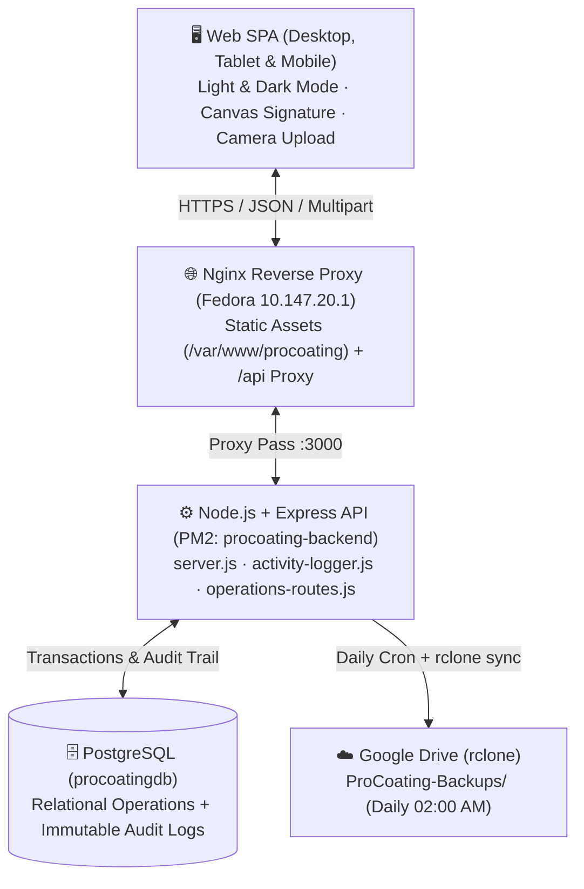
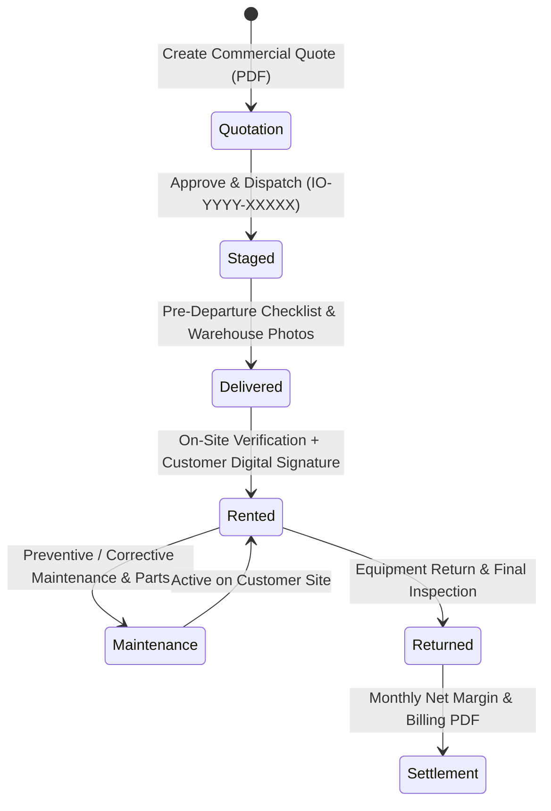

# ❄️ PRO-Coating Management System (`ProCoating`)

> **Enterprise Operations, Equipment Rental, Fleet Traceability, Maintenance Costing, User RBAC, Audit Logging & Automated Disaster Recovery Platform**  
> Built and deployed for **PRO-Coating Treatments Inc.**

[](https://nodejs.org/)
[](https://www.postgresql.org/)
[](https://nginx.org/)
[](https://rclone.org/)
[](#)

---

## 🎯 Executive Overview

**PRO-Coating Management System** centralizes the full commercial, logistical, technical, and financial lifecycle of industrial HVAC, chiller, dehumidification, and coating equipment rentals.

Every commercial quote (`Q-YYYY-XXXXX`) links directly to an internal dispatch order (`IO-YYYY-XXXXX`), warehouse staging accessories, pre-departure and on-site verification checklists, multi-stage photographic evidence, customer digital signature capture, preventive/corrective maintenance cost tracking, monthly financial settlement, and an immutable user activity audit trail.

---

## 🏗️ System Architecture & Production Topology



---

## 🚀 What's New — Operational & Security Modules

### 1. End-to-End Quotation-to-Settlement Lifecycle



* **3-Section Aligned Dispatch Form (`frontend/js/operations-lifecycle.js`):**
  1. **Quotation & Customer Traceability:** Mandatory link to `quotation_id`, auto-filled customer account, and on-site contact selector.
  2. **Equipment, Field Crew & Logistics Schedule:** Equipment unit, monthly rate, scheduled delivery date, fleet truck/trailer, driver/transporter, installing technician, and site rigging notes.
  3. **Staged Accessories, Hoses, Ducts, Cables & Supplies:** Dynamic warehouse item picker with category, description, quantity, and unit.
* **4-Stage Field Execution Hub (`Checklist, Sign & Parts`):**
  1. **Pre-Departure & On-Site Checklist:** 6-point technical inspection signed off at **Warehouse** before departure and **On-Site** with the customer.
  2. **Multi-Stage Photo Evidence:** Camera/file uploads categorized by stage (*Pre-Departure*, *Delivery & Rigging*, *Installation & Startup*, *Preventive / Corrective Maintenance*).
  3. **Customer Handover & Digital Signature:** HTML5 canvas signature embedded into the downloadable Handover PDF, transitioning unit status to **`Rented`**.
  4. **Maintenance & Spare Parts Cost Log:** Logs preventive/corrective maintenance and automatically deducts warehouse inventory, consolidating net margins in **`💰 Monthly Settlement`**.

### 2. Fleet Traceability & Code 128B Barcode Labels
* **Equipment Fleet History (`frontend/js/equipment-history.js`):** Binds each unit card in **`❄️ Equipment Fleet & Catalog`** (`121+` units) by Serial Number (`S/N`) and opens an audit timeline of every status change (`Available` → `Staged / Prepared` → `Delivered` → `Rented` → `Returned / Completed`), operator, and order.
* **Warehouse Barcode Printing (`frontend/js/inventory-labels.js`):** Generates 2×5 Letter-size **Code 128B** PDF label sheets (`Print New Batch`, `Print Pending`, `Print Full Catalog`) plus single-SKU box labels (`272+` items).

### 3. User Administration (`Users & Roles`), Audit Trail (`Audit Logs`) & Dark Mode
* **User CRUD & Profile Security (`frontend/js/user-management.js`):** Manage administrator (`role_id = 1`: `admin`, `abarney` — Andrés Barney, `adbarney` — Adriana Barney) and operator (`role_id = 2`) accounts, reset passwords, toggle active status (`is_active`), and update personal profiles (`/api/users/me`).
* **Immutable Activity Audit Log (`backend/activity-logger.js` & `frontend/js/activity-audit.js`):** Global Express interceptor recording `LOGIN`, `CREATE`, `UPDATE`, `DELETE`, `SIGN_OFF`, `CHECKLIST`, `UPLOAD_PHOTO`, `ADD_COST_PART`, `PASSWORD_RESET`, and `BACKUP` in `user_activity_logs` with IP address, sanitized JSON payloads (`[REDACTED]` credentials), filters, and CSV export (`/api/activity-logs/export.csv`).
* **Adaptive Dark Mode (`frontend/js/theme-compat.js`):** High-contrast styling across warning banners (`Stock Alert`), forms, tables, and modals.

---

## 🗄️ Database Architecture & REST API Reference

| Table | Purpose | Key Endpoints |
| :--- | :--- | :--- |
| `quotations` | Commercial quotes linked to clients | `GET /api/operations/lookups` |
| `internal_orders` | Dispatch orders linked to quotations | `GET/POST /api/internal-orders`, `GET /api/internal-orders/:id/pdf` |
| `order_checklists` | Dual warehouse & on-site verification | `POST /api/internal-orders/:id/checklist` |
| `order_photos` | Stage-tagged delivery & service photos | `POST /api/internal-orders/:id/photos` |
| `order_handovers` | On-site receiver & digital signature | `POST /api/internal-orders/:id/handover` |
| `order_expenses` | Maintenance & spare parts cost log | `POST /api/internal-orders/:id/expenses`, `GET /api/settlement/monthly` |
| `equipment_status_history` | Equipment lifecycle audit trail | `GET /api/equipment/:id/history` |
| `users` & `roles` | RBAC accounts & profile security | `GET/PUT /api/users/me`, `GET/POST/PUT/DELETE /api/users`, `PATCH /api/users/:id/password` |
| `user_activity_logs` | Immutable user traceability trail | `GET /api/activity-logs`, `GET /api/activity-logs/export.csv` |

---

## 📁 Repository Structure & Disaster Recovery Runbook

```text
ProCoating/
├── backend/
│   ├── server.js                 # Express server entry point, auth & global audit hook
│   ├── activity-logger.js        # Global user traceability middleware & /api/activity-logs routes
│   └── operations-routes.js      # Dispatch, checklist, photos, handover, settlement & user CRUD API
├── frontend/
│   ├── index.html                # Main SPA shell & module script loader
│   └── js/
│       ├── operations-lifecycle.js  # Dispatch & Orders, 4-stage handover hub & Monthly Settlement UI
│       ├── equipment-history.js     # Equipment Fleet card Serial Number traceability integration
│       ├── inventory-labels.js      # Warehouse Code 128B barcode label toolbar & row actions
│       ├── user-management.js       # Users & Roles CRUD + My Account quick password update UI
│       ├── activity-audit.js        # Audit Logs filter console, JSON inspector & CSV export UI
│       └── theme-compat.js          # Dark Mode & Light Mode contrast compatibility stylesheet
├── scripts/
│   └── backup-procoating.sh      # Full-stack DB + Backend + Frontend backup & rclone Google Drive sync
└── README.md                     # Technical & operational documentation
```

### Automated Daily Backup & Restore (`rclone` + Google Drive)
Daily backups run at **`02:00 AM`** via `/usr/local/bin/backup-procoating.sh`, bundling PostgreSQL schema + data (`pg_dump`), Backend, and Frontend into `/var/backups/procoating/ProCoating_FULL_Backup_YYYY-MM-DD_HHMM.tar.gz` and syncing off-site to **`Google Drive / ProCoating-Backups`**.

```bash
# Run manual full-stack backup & Google Drive upload
sudo /usr/local/bin/backup-procoating.sh

# Verify Off-Site Google Drive Backups
sudo rclone ls gdrive_procoating:ProCoating-Backups/

# Restore database from full backup archive
tar -xzf ProCoating_FULL_Backup_YYYY-MM-DD_HHMM.tar.gz
sudo -u postgres psql -d procoatingdb -f ProCoating_FULL_Backup_*/1_database/procoatingdb_schema_and_data_*.sql
```