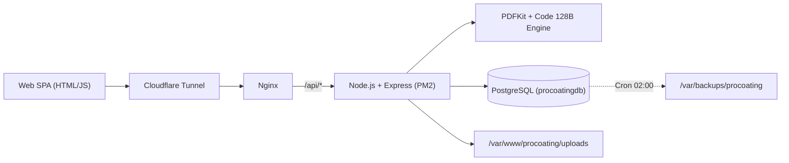
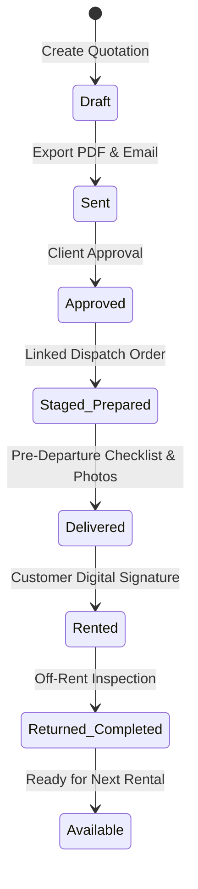

# PRO-Coating Treatments Inc. — Enterprise Operations Platform

Full-stack HVAC/R equipment rental, protective coating (*ADSIL MicroGuard®*), quotation-linked dispatch, warehouse barcode inventory, and monthly financial settlement system for **PRO-Coating Treatments Inc.** (`procoatingpr.com` | `sales@procoatingpr.com` | `787-309-8738`).

## 1. System Architecture

## 2. Operational Lifecycle & Equipment Traceability

## 3. Core Functional Modules

* **Multi-Contact Directory (`frontend/js/customer-contacts.js`):** Multiple contacts per account (`customer_contacts`) with role and primary flag.
* **Commercial Quotations (`Quotations (PDF)`):** Branded PDF proposals (`QT-YYYY-XXXXX.pdf`), email drafts, and one-click `Approve & Dispatch`.
* **Quotation-Linked Dispatch (`Dispatch & Orders`):** Mandatory `quotation_id` link (`IO-YYYY-XXXXX`), crew/truck assignment, 6-point checklist, photos, HTML5 signature pad, and signed Handover PDF.
* **Monthly Settlement (`Monthly Settlement`):** Logs spare parts (auto-deducting `stock_quantity`), supplies, transport, and labor (`Billable` vs `Non-Billable`) with monthly PDF liquidation.
* **Warehouse Box Barcodes (`frontend/js/inventory-labels.js`):** ISO/IEC 15417 **Code 128B** labels (2x5 per Letter sheet) for 272 SKUs (564 units).

## 4. Database Schema, REST API & Operations

* **Tables (`procoatingdb`):** `customers`, `customer_contacts`, `equipment`, `equipment_status_history`, `quotations`, `quotation_items`, `internal_orders`, `internal_order_items`, `internal_order_checklists`, `internal_order_photos`, `internal_order_expenses`, `spare_parts`, `inventory_movements`.
* **PDF & Barcode Endpoints:** `GET /api/quotations/:id/pdf` | `GET /api/internal-orders/:id/pdf` | `GET /api/monthly-settlement/pdf?month=YYYY-MM` | `GET /api/inventory/labels/pdf?scope=new|pending|all`.
* **PM2 & Cron Backups:** Supervised via PM2 (`procoating-backend`, `procoating-tunnel`). Daily 02:00 AM cron `/usr/local/bin/backup-procoating.sh` stores `pg_dump -Fc` and `uploads` archives in `/var/backups/procoating/` (14-day retention).
