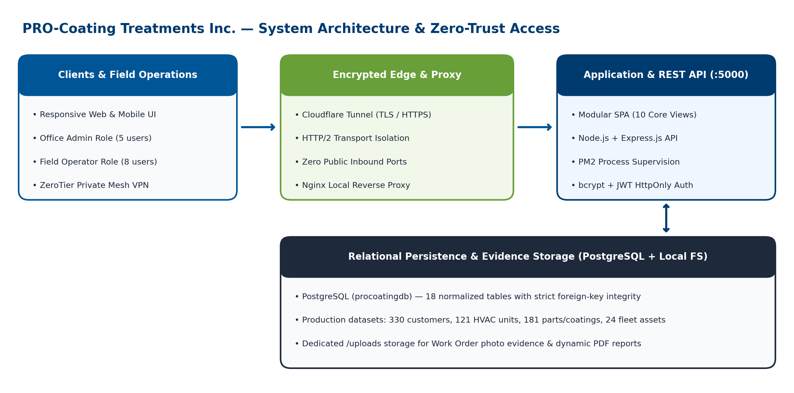
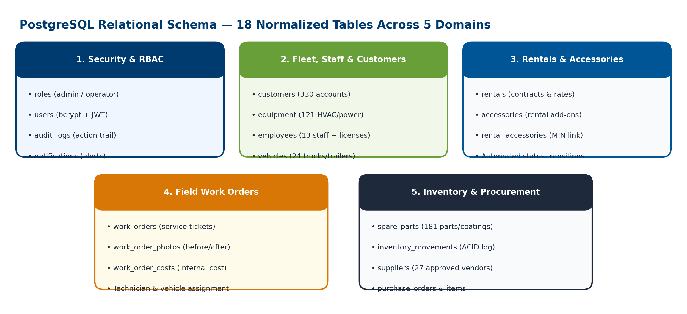
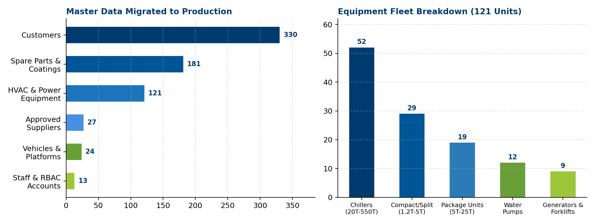

<div align="center">
  
  <h1>PRO-Coating Management System</h1>
  <p><strong>Enterprise Operations, HVAC Equipment Rental, Field Maintenance & Inventory Platform (24/7)</strong></p>

  <p>
    
    
    
    
    
  </p>
</div>

---

## Overview

**PRO-Coating Management System** is a full-stack operational management platform built for **PRO-Coating Treatments Inc.** (Puerto Rico) to centralize industrial HVAC/chiller rentals, protective coating operations, field work orders, spare-parts inventory, fleet compliance, and procurement.

### Production Footprint & Master Data Pipeline
* **330 Commercial & Pharmaceutical Customers** normalized with phone numbers, email contacts, and billing/shipping addresses.
* **121 Industrial & HVAC Equipment Units** indexed with individual serial numbers (`S/N`), tonnage, voltage, amperage, refrigerant type, and availability status.
* **181 Spare Parts & Industrial Coatings** (*Chillco, Trane, Daikin, Johnson Controls, Oldach, Adsil MicroGuard1, ADVANCOAT Surfsil, JCC Chemical*) with reference pricing and ACID stock movements.
* **24 Fleet Vehicles & Platforms** tracked with registration numbers, license plates (`tablillas`), tag expiration dates (`marbetes`), and inspection status.
* **13 Active Staff Profiles** linked to driver's licenses, HVAC technician licenses, TWIC, APPR, and Public Service Commission (CSP) permits.

---

## System Architecture

<p align="center">
  
</p>

1. **Presentation Layer (`frontend/`):** Responsive SPA built with HTML5, custom CSS3 (including Dark Mode), modular ES6+ controllers, and Chart.js visualizations.
2. **Application & API Layer (`backend/`):** Node.js and Express.js REST API supervised by **PM2**, featuring transactional inventory controls, Multer multipart image uploads for field evidence, dynamic PDF report generation, and interactive **OpenAPI / Swagger UI** at `/api-docs`.
3. **Persistence Layer (`database/`):** Normalized **PostgreSQL** schema (`18` tables) enforcing foreign-key constraints across customers, equipment, rentals, work orders, inventory movements, and audit trails.
4. **Zero-Trust Edge Security:** Exposed externally via **Cloudflare Tunnel** over `HTTP/2` with TLS encryption and strict CORS validation, eliminating open inbound firewall ports.

---

## Core Functional Modules

| Module | Key Capabilities |
| :--- | :--- |
| **1. Executive Dashboard** | Real-time KPIs, fleet utilization status, low-stock alerts, and interactive operational charts. |
| **2. Customers** | Full CRM directory for industrial, commercial, and pharmaceutical accounts across Puerto Rico. |
| **3. Equipment Fleet** | Live-searchable catalog of chillers (20T–550T), package units, compact AC units, water pumps, generators, and forklifts with `S/N` tracking. |
| **4. Rentals** | Equipment and accessory rental contracts, daily rate calculations, delivery/return scheduling, and automated availability locking. |
| **5. Work Orders** | Field service dispatch, technician assignment, before/after photo evidence uploads (`/uploads`), and internal job costing. |
| **6. Inventory** | Real-time stock control for chiller components and protective coatings with transactional `+/- Stock` adjustments (`POST /api/inventory-movements`). |
| **7. Purchase Orders** | Supplier purchase order creation and goods-receiving workflow that automatically increments warehouse stock levels. |
| **8. PDF Reports** | Corporate-branded PDF reporting for rentals, maintenance activity, and executive summaries. |
| **9. Backup & Audit Logs** | Database backup utilities and chronological audit logging of critical user actions. |
| **10. Notifications & API Docs** | In-app notification center and self-hosted Swagger API documentation (`/api-docs`). |

---

## Database Model & Production Metrics

<p align="center">
  
</p>

<p align="center">
  
</p>

---

## Quick Start

```bash
# 1. Create PostgreSQL database and load clean DDL schema
createdb procoatingdb
psql -d procoatingdb -f database/schema.sql

# 2. Configure and start backend API
cd backend
cp .env.example .env
npm install
pm2 start server.js --name procoating-backend
```

---

## Author

**Alexander Mosquera Fajardo**  
Business Administrator & Systems Engineer — Data & Software Architecture  
GitHub: [@alexelgordo72](https://github.com/alexelgordo72)
